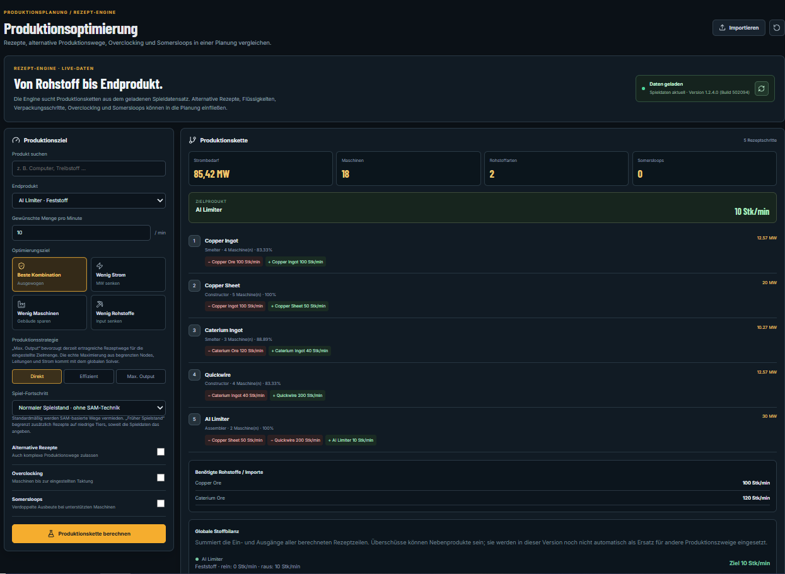
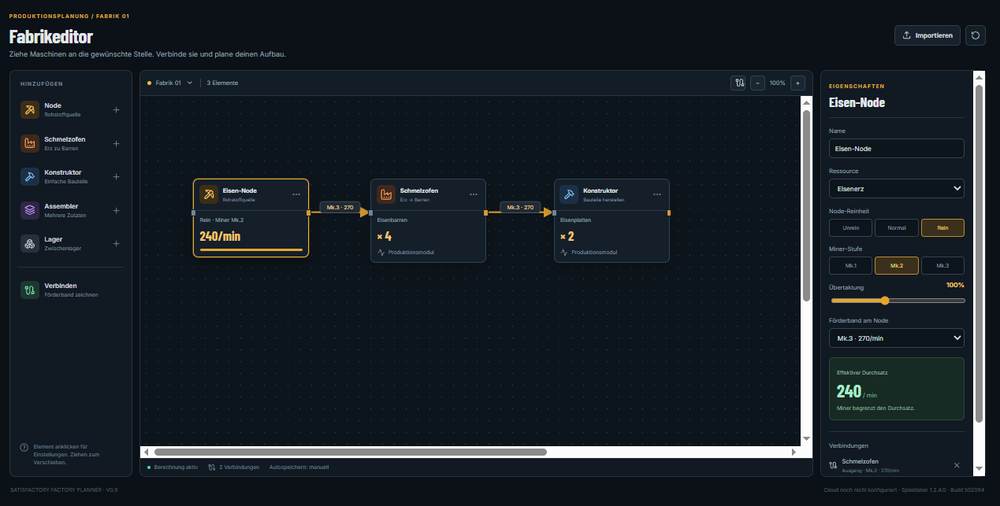
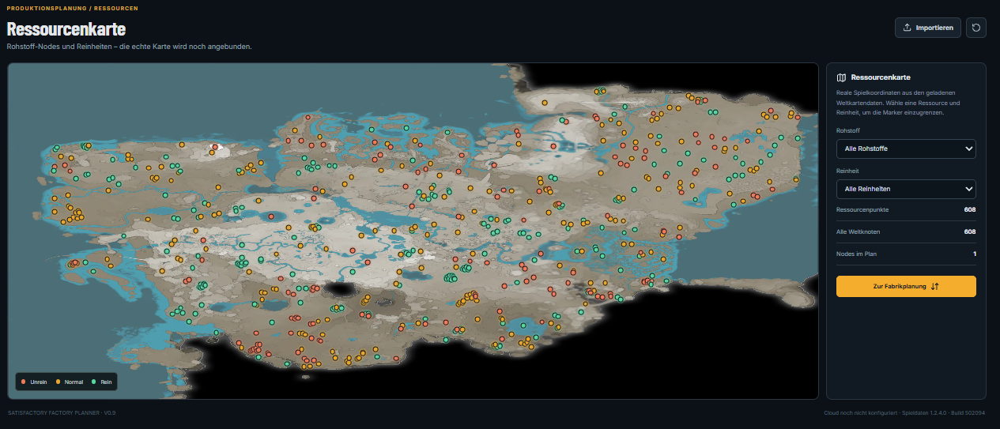
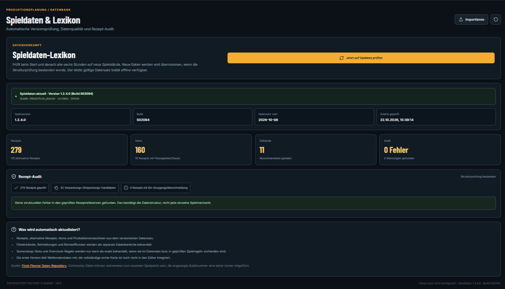

# Satisfactory Factory Planner

**Plan production chains. Compare recipes. Design your factory.**

[**Open the live web app →**](https://protheanreact.github.io/satisfactory-factory-planner-v7/)

Satisfactory Factory Planner is a browser-based planning tool for *Satisfactory*. It combines production-chain calculations, a visual factory editor, a resource map and version-aware game-data checks in one dark, compact interface.

> The screenshots show the application UI and example data. Calculations are planning aids; verify important layouts and rates against the game version you play.

## Screenshots

### Production optimizer

Compare production paths for a target item and review machine count, power use and required inputs. Choose an optimization objective and configure alternative recipes, overclocking and Somersloops.



### Visual factory editor

Place production nodes, configure machines and connect them to sketch a factory layout. Projects can be imported and exported as JSON.



### Resource map

Explore resource-node locations on the world map and filter them by resource and node purity.



### Game data and recipe audit

Review the loaded game-data version, item and recipe counts, and structural recipe-audit results. The app checks for updates and retains a validated cached dataset for fallback use.



## Features

- **Production planning:** calculate a target production chain and compare available recipe variants.
- **Optimization objectives:** best combination, low power use, fewer machines or lower raw-resource demand.
- **Production strategies:** Direct, Efficient and Maximum Output.
- **Recipe options:** optionally include alternate recipes, overclocking and Somersloops.
- **Transparent balances:** show material inputs and outputs for the calculated chain, including possible deficits and surplus by-products.
- **Factory editor:** place and connect production elements, adjust machine and belt settings, and import/export project JSON.
- **Resource map:** inspect resource nodes and filter by resource and purity.
- **Game-data checks:** display dataset version/build, refresh data and audit recipe references.
- **Local caching:** use the last successfully validated game-data snapshot when an update source is unavailable.
- **Cloud sync:** Supabase-backed cloud saving is supported when the cloud configuration is enabled.
- **Desktop packaging:** the project includes Electron packaging groundwork for a portable Windows x64 build; a release executable is not included in this repository by default.

## Live demo

[https://protheanreact.github.io/satisfactory-factory-planner-v7/](https://protheanreact.github.io/satisfactory-factory-planner-v7/)

The web version is deployed with GitHub Pages. Some features, such as cloud saving, depend on the corresponding environment configuration.

## Run locally on Windows

### Requirements

- Node.js LTS (Node 20 or newer recommended)
- npm, installed with Node.js
- Git, if you clone the repository

### Install and start

```powershell
git clone https://github.com/Protheanreact/satisfactory-factory-planner-v7.git
cd satisfactory-factory-planner-v7
npm ci
npm run dev
```

Open the local URL printed by Vite, usually `http://localhost:5173`.

### Build and test

```powershell
npm test
npm run build
```

The production build is written to `dist/`.

## Game data

The app loads versioned community game data from the [Ficsit Planner data repository](https://github.com/Albis0/ficsit_planner) (`src/data`). This is a community-maintained source, not an official Coffee Stain Studios API. The displayed dataset version can lag behind a new game patch, so compare important production rates with the exact Satisfactory version you use.

## Known limitations

- The production solver is a bounded heuristic search, not a global linear or mixed-integer optimization solver. A result is a useful candidate, not a mathematical proof of the globally optimal solution.
- Resource-node limits, belt and pipe capacities, available power, shard inventory and Somersloop placement are not all jointly optimized as one global constraint system.
- Material balances are shown transparently, but surplus by-products are not automatically reused to optimize every other branch of the chain.
- The recipe audit checks data structure and references; it does not prove that every in-game mechanic is modeled perfectly.
- Game data may lag behind the current game release.

## Contributing

Issues and pull requests are welcome. When reporting a problem, include the app version, Satisfactory game version, target item, production rate, selected recipe options and a short description of the expected versus actual result. Please avoid including secrets or Supabase credentials in issues.

## English summary

Satisfactory Factory Planner is a browser-based planning tool with a production optimizer, node-based factory editor, resource map and game-data/recipe audit. It supports recipe variants, configurable optimization goals, local game-data caching and optional Supabase cloud saving. Its solver is heuristic, so results should be checked against the game version in use.

**Live demo:** [Open Satisfactory Factory Planner](https://protheanreact.github.io/satisfactory-factory-planner-v7/)
